

  
  
     
  
  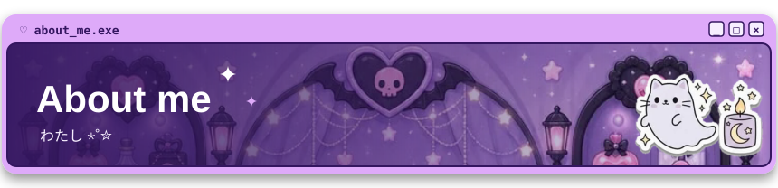
  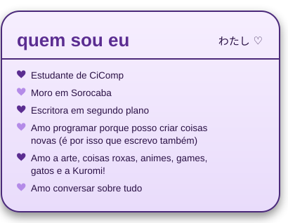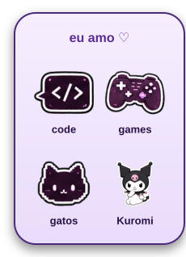
  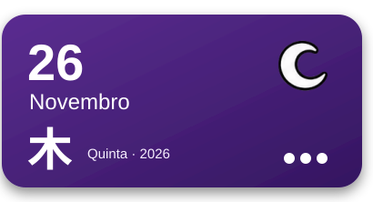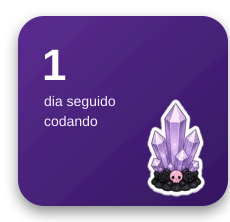
  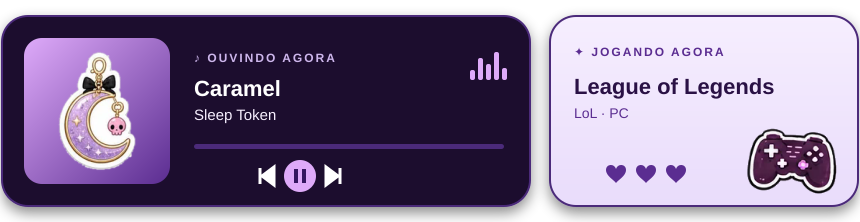
     
  
  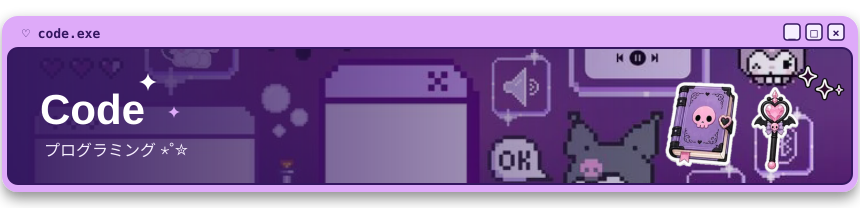
  
  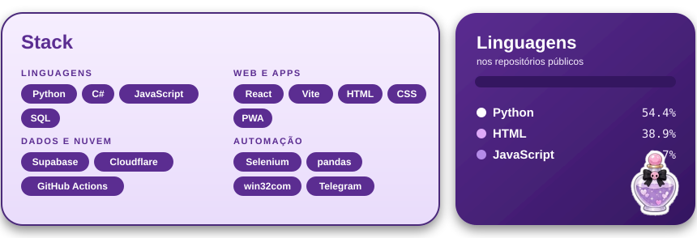
  
     
  
  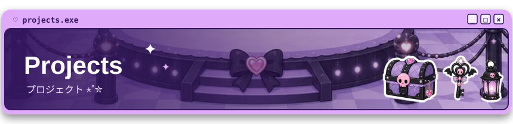
  <a href="https://github.com/Rhebecca-Taih/planejador-financeiro-vitrine">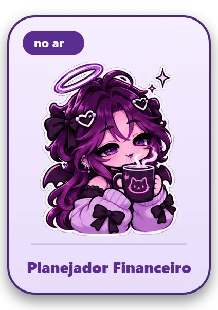</a>
  <a href="https://arcano.bheccstaih.workers.dev">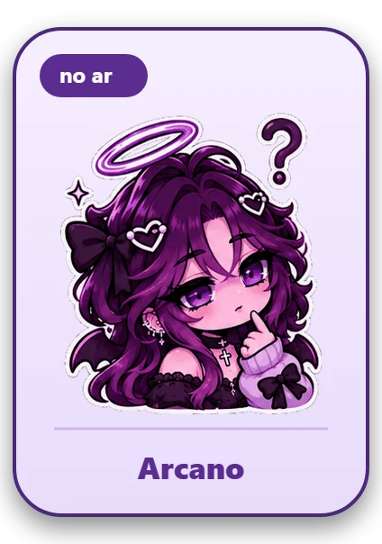</a>
  <a href="https://github.com/Rhebecca-Taih/vagas-bot">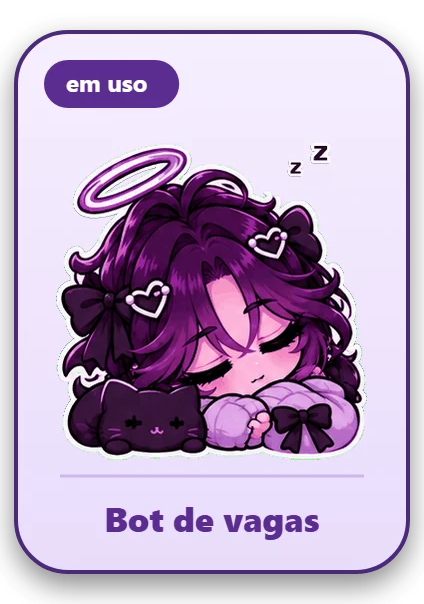</a>
  <a href="https://github.com/Rhebecca-Taih/RFID">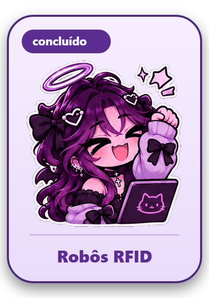</a>
    

  
<picture></picture>

  

     
    
    
    
  

  

